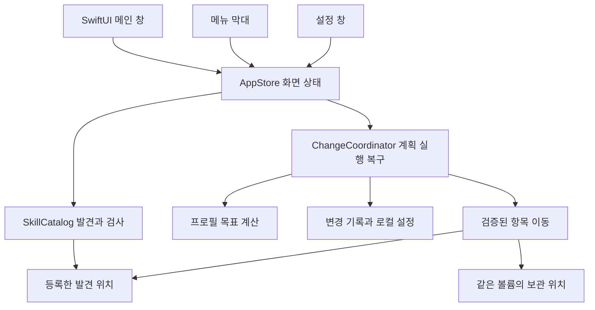

# Agent Plugin Manager 개발 아키텍처

한 macOS 앱에서 발견, 변경 계획, 실행, 복구를 처리합니다. 파일 변경은 하나의 모듈로 모아 메인 창과 메뉴 막대가 같은 규칙을 사용하게 합니다. 서버와 계정은 첫 버전의 요구에 포함되지 않습니다.

사용자가 확정한 기술은 SwiftUI입니다. 최소 macOS 26, 직접 배포, 로컬 JSON 저장은 이번 설계에서 선택한 제안입니다. 지원 에이전트는 Codex와 Claude Code이며 아래 발견 위치와 재발견 동작은 2026년 10월 1일 확인한 공식 문서를 기준으로 합니다.

이 문서는 첫 버전의 목표 계약입니다. 현재 앱 대상 하나와 `SkillCore` 패키지로 읽기 전용 탐색·원문 읽기와 네이티브 화면을 구현했습니다. 앱의 예시 모드와 가상 데이터는 제거했습니다. 자동 사용자 스킬 경로와 수동으로 등록한 정확한 스킬 경로를 읽으며, 추가 경로와 작업 구성 메타데이터를 앱별 UserDefaults의 JSON 데이터로 저장·복원합니다. 구성은 현재 스캐너의 설치 항목 ID, 이름, 에이전트 이름과 경로 참조를 보관합니다. 저장 경로는 표시용이며 원문 열기는 현재 발견한 항목을 통해서만 수행합니다. 미발견 참조를 자동 삭제하거나 동명 항목으로 대체하지 않습니다. 손상된 구성 데이터는 보존하고 쓰기를 막습니다. 구성 선택·저장은 스킬 파일을 바꾸지 않습니다. 등록 해제는 설정만 변경합니다. 외형 설정 역시 UserDefaults를 사용합니다. 아래의 목표 `state.json`·영속 ID·출처 연결·프로필의 관리 범위/목표 적용·변경 계획·파일 이동·복구는 아직 구현하지 않았습니다. 쓰기를 연결하기 전에 경로 설정과 구성 메타데이터를 목표 저장·잠금 계약 및 영속 설치 항목 ID에 통합해야 합니다. 전체 에이전트 발견 규칙·물리적으로 동일한 루트 합치기·공유 원본 관계 그래프는 후속 구현입니다. 다른 에이전트의 수동 경로는 SKILL.md 조회만 지원합니다. 현재 범위는 [README](../README.md#네이티브-앱-실행)에 기록합니다.

## 플러그인 중심 확장 방향

2026-10-02 제품명은 **Agent Plugin Manager**로 확정했습니다. 전체 제품 방향은 [README](../README.md#제품-방향)를 따르며 아래 스킬 발견·파일 이동·복구 계약은 현재 스킬 관리의 명세입니다. 제품명 변경만으로 `SkillEntry`를 모든 종류의 관리 항목으로 바꾸거나 현 파일 이동 경로에 다른 종류를 추가하지 않습니다.

플러그인 패키지와 포함 기능의 관계는 매니페스트 또는 공식 설치 기록으로 확인합니다. 출처 저장소·패키지 소속·설치 위치·관리 주체를 별개로 유지합니다. 단독 스킬과 MCP·훅·지침은 원래 종류로 조회하며 패키지로 변환하지 않습니다. 제공자 관리 플러그인의 설치·갱신·활성 변경은 해당 에이전트의 공식 방법을 검증한 뒤 별도 계획으로 연결합니다. 현재 읽기 전용 캐시 보호는 그때까지 유지하고 플러그인 내부 파일을 개별 스킬처럼 보관하지 않습니다.

지원은 에이전트와 종류별로 추가합니다. 발견 규칙, 지원 작업, 패키지 형식, 상태 확인과 재반영 방법을 각각 검증하며 다른 에이전트가 같은 플러그인 형식을 채택할 것이라고 가정하지 않습니다. 실제 두 번째 지원 구현이 필요해질 때 공통 부분을 추출하며 지금 범용 플러그인 프로토콜이나 실행 모듈을 만들지 않습니다. 지침은 파일별 로딩·충돌 규칙을 별도로 확인하고 실행 루프는 관리하지 않습니다.

제품명 전환과 기존 사용자 설정의 기술 식별자 전환은 별도 단계입니다. 현재 프로젝트·scheme·Bundle ID·UserDefaults 도메인을 유지하며 이름 전환 시 기존 구성·경로 설정과 설치 앱을 함께 검증해야 합니다.

## 앱 구성



앱 대상 하나와 테스트 가능한 `SkillCore` Swift 패키지 하나로 시작합니다. 모듈의 인터페이스는 외부 호출자가 알아야 하는 동작, 전제와 실패 결과까지 포함합니다. 제품별 발견 규칙은 데이터와 작은 함수로 표현하고, 구현이 하나인 기능에 프로토콜이나 팩토리를 추가하지 않습니다.

| 모듈 | 책임 | 외부 인터페이스 |
| --- | --- | --- |
| AppStore | 메인 스레드에서 화면 상태, 선택, 검사 진행, 계획과 실행 결과 보유 | 검사 요청, 미리보기 요청, 계획 적용, 복구 요청 |
| SkillCatalog | 위치별 발견, 링크 관계, 메타데이터 파싱, 기본 검사 | `scan(scope) → Snapshot` |
| ChangeCoordinator | 변경 범위 검증, 계획 작성, 기록, 이동, 복구 | `preview(intent, snapshot, policy) → Plan`, `apply(planID) → Result`, `recover() → RecoveryResult`, `reconcile(resolution) → Result` |
| ProfilePlanner | 관리 범위에서 원하는 파일 상태를 계산 | `desiredState(profile, snapshot, policy) → DesiredEntries` |

파일 접근과 기록 처리는 ChangeCoordinator 내부에 둡니다. 같은 파일 이동 규칙을 UI에서 재구현하지 않습니다. 코어 테스트는 모듈의 인터페이스를 호출하고, 실패 주입이 필요한 파일 이동 지점만 내부 seam으로 둡니다.

## 상태 소유와 실행

AppStore는 `@MainActor`와 Observation을 사용하고 앱이 한 번 생성합니다. 첫 버전은 메인 창 하나와 설정 창을 제공합니다. 메인 창, 설정, 메뉴 막대가 같은 인스턴스를 참조합니다. 검색어·선택 항목·스크롤은 해당 뷰가 소유합니다. 메뉴 막대는 메인 창의 미리보기를 열며 별도의 즉시 실행 경로를 만들지 않습니다. 화면당 ViewModel을 자동으로 만들지 않습니다.

검사와 읽기는 UI 스레드 밖에서 실행합니다. 이전 검사 결과가 더 최신 결과를 덮어쓰지 않도록 검사 세대를 비교합니다. 미리보기는 부작용 없이 만들며, 파일 실행은 화면 닫기나 검색 취소와 수명을 공유하지 않습니다.

검사 작업의 세대와 내용이 바뀔 때의 `catalogRevision`을 구분합니다. 같은 내용의 재검사가 완료됐다는 이유만으로 계획을 무효화하지 않습니다. 고정·프로필·그룹·관리 범위·발견 및 보관 위치의 변경은 `policyRevision`을 바꾸고 해당 열린 계획을 폐기합니다. 외형과 즐겨찾기는 실행 정책을 바꾸지 않습니다.

ChangeCoordinator는 쓰기를 한 번에 하나만 허용합니다. actor의 직렬성만 믿지 않고 `await` 사이 재진입을 막는 실행 상태를 둡니다. 두 앱 프로세스의 동시 변경은 로컬 잠금으로 차단합니다. 이 잠금은 다른 편집기나 에이전트의 파일 변경까지 막지 못하므로 실행 전후 실제 항목 검증도 필요합니다.

실행·복구 중에는 고정·관리 범위·그룹·프로필·관련 발견 루트·보관 위치처럼 안전 조건에 영향을 주는 설정 편집을 막습니다. 읽기·검색·외형·즐겨찾기는 계속 허용합니다. 창 닫기는 실행 취소가 아닙니다. 실행 중 Escape와 취소 행동은 `중단 요청`이며 진행 화면을 숨기는 대신 다음 이동 전 중단하고 원형 복구를 시작합니다. 일반 앱 종료도 기록 저장과 안전한 중단 경로를 사용합니다.

## 핵심 데이터 모델

| 모델 | 보유할 정보 | 불변 조건 |
| --- | --- | --- |
| DiscoveryRoot | ID, 경로 별칭, 정규 경로, 볼륨·디렉터리 식별 정보, 에이전트 목록, 범위, 관리 주체, 접근 상태, active | 같은 실제 발견 위치를 중복 등록하지 않음. 비활성화해도 기록에 필요한 정보 보존 |
| Snapshot | catalogRevision, 항목·원본·관계, 위치별 발견 완료 여부와 이유, 본문 검사 상태 | 항목 ID 유일, 발견 불완전성을 정상 결과로 숨기지 않음 |
| SkillEntry | ID, rootID, 원래 상대 위치, 현재 위치, 폴더·링크 구분, 원본 ID, 항목 식별 정보, 메타데이터, 파일 상태, 읽기·변경 가능 여부 | 이름만으로 합치지 않음. 같은 경로의 폴더 교체를 기존 항목으로 자동 승계하지 않음 |
| SourceIdentity | ID, 볼륨·파일 식별 정보, 원본 위치, 선택적 원본 entryID, 참조 항목, 승인·접근·존재 상태 | 설치 항목이 아닌 공용 폴더도 표현. 링크 자체 존재와 원본 가용성 구분 |
| OriginRepository | ID, 호스트·저장소 식별자, 표시 이름, 선택적 저장소 URL | 출처 분류용. 공유 원본·발견 루트·파일 변경 권한과 독립 |
| Provenance | entryID, repositoryID, 선택적 저장소 내부 상대 경로·설치 revision·배포 묶음 식별자, 설치 방식, 근거 종류·위치·확인 시각 | 항목별 기록. 수동 지정과 확인된 기록을 구별하며 미확인 필드는 비워 둠 |
| Variant | 이름, 본문 해시, 관련 설치 항목 | 본문 일치만으로 전체 스킬 묶음 동일성을 주장하지 않음 |
| Group | ID, 이름, 색상, 설치 항목 ID 목록 | 그룹 편집은 파일을 옮기지 않음 |
| Profile | ID, 이름, managedEntryIDs, groupIDs, entryIDs | 직접 목표와 그룹의 목표는 관리 범위 안에 존재해야 함 |
| ManagementPolicy | policyRevision, 앱 전체 pinnedEntryIDs, 등록·보호 위치, 변경 한도 | 고정은 프로필별 설정이 아님. 고정 변경 자체는 파일 변경 0건 |
| Finding | ruleID, 대상 에이전트, severity, entryID, 근거 위치·참조 자료 지문, 검사 시각 | 본문·링크·참조 파일 등 실제 검사 근거가 바뀌면 오래된 결과 |
| ChangePlan | ID, catalogRevision, policyRevision, 의도, 관리 범위, 이동·유지·영향 목록, 이유 코드·관련 ID·가능한 행동, 대상·관계 지문, 사용 여부 | 차단과 변경 없음 구분. UI가 이유 문구를 해석해 변경 대상을 만들지 않음 |
| OperationRecord | ID, 순번, 계획, 루트·보관 위치 식별 정보, 이동별 from/to·전후 지문·진행 상태, 오류, 복구·설정 반영 상태 | 실행·중단 복구·완료 기록 되돌리기 구분. 기록이 이동보다 먼저 저장 |

Entry ID는 처음 관찰한 등록 위치와 원래 상대 경로에 연결해 영속화합니다. 앱이 보관한 경우 ID는 유지합니다. 앱이 아닌 외부 도구가 항목을 옮겼다면 임의로 동일 항목이라고 합치지 않고 원래 항목 누락과 신규 항목을 표시합니다.

동일 위치의 별칭은 물리적 디렉터리 식별 정보로 합치고 사용하는 에이전트 목록을 보유합니다. 서로 다른 중첩 위치의 조회 등록은 허용합니다. 폴더 자체가 교체되면 기존 항목은 누락·교체됨으로, 새 폴더는 신규 후보로 기록하고 프로필·고정을 자동 승계하지 않습니다. 같은 폴더 안의 일반적인 SKILL.md 편집은 동일 항목입니다. 식별 정보를 신뢰할 수 없으면 조회는 허용하되 자동 승계·이동은 차단합니다. Snapshot 또는 저장된 설정의 중복 ID는 계획 생성 전에 차단합니다.

## 출처 저장소와 분류 계약

출처 저장소는 설치 항목을 찾는 분류 축입니다. 수동 그룹은 서로 다른 출처의 항목도 모을 수 있고, 프로필은 명시적인 관리 범위에서 사용할 목표를 저장합니다. 저장소 분류를 바꾸거나 필터를 고르는 행동은 그룹·프로필·파일 상태를 바꾸지 않습니다. `SourceIdentity`는 링크의 물리적 공유 원본이며 출처 저장소 ID를 넣지 않습니다.

출처는 승인된 위치에서 읽을 수 있는 설치 기록·매니페스트처럼 항목과 저장소를 명시적으로 연결하는 근거가 있으면 기록합니다. 설치 도구별 기록 형식은 해당 어댑터 구현 때 확인합니다. 모든 설치 도구가 영수증을 남긴다고 가정하지 않습니다. 이름·본문 유사성·폴더명·README 링크만으로 출처를 확정하지 않습니다. 근거가 없으면 `출처 미확인`이며 사용자가 연결한 값은 `사용자 지정`으로 표시합니다. 직접 만든 항목은 사용자가 표시한 경우 `직접 작성`으로 구별합니다. 내용이나 설치 폴더가 교체돼 기록과의 연결이 불명확해지면 근거를 재검증하며 예전 확인 상태를 자동 승계하지 않습니다.

동일 저장소 안의 스킬은 내부 상대 경로로 구별하고 설치 revision은 근거가 있을 때만 저장합니다. 이름이 같거나 출처와 revision이 같아도 설치 항목 ID는 합치지 않습니다. 원격 전체 목록이나 변경 내역을 읽지 않은 상태에서 `전체 스킬 수`, `최신`, `업데이트 가능`을 표시하지 않습니다. 첫 버전의 수치는 현재 등록 위치에서 관찰한 **설치 항목 수**이며 오프라인·비공개 출처도 로컬 분류는 유지합니다. 등록한 출처에 관찰된 항목이 0개여도 저장소가 비어 있다고 표현하지 않습니다.

출처와 관리 주체는 독립입니다. 같은 저장소의 사용자 복사본과 제공자 관리 플러그인 항목을 함께 표시하되 쓰기 판단은 기존 Ownership·보호 경로 계약을 따릅니다. 저장소를 등록하거나 수동 출처를 지정해도 파일 접근·변경 권한을 얻지 않습니다. [mattpocock/skills의 설치 안내](https://github.com/mattpocock/skills)는 편집 가능한 파일 설치와 관리되는 플러그인 묶음을 별도로 설명하므로, 저장소 하나를 설치 단위 하나로 가정하지 않습니다. 배포 묶음의 스킬·명령·도구 구성은 매니페스트로 확인한 경우에만 연결하며 첫 버전에서 묶음을 분해하거나 개별 플러그인 스킬을 보관하지 않습니다.

`선택한 설치 항목으로 그룹 만들기`는 사용자가 선택한 entryID의 스냅샷을 기존 Group에 저장하는 행동으로 설계합니다. 저장소 구독이나 동적 그룹이 아니므로 이후 추가된 항목은 자동 편입되지 않습니다. 그룹을 프로필에 연결하려면 기존의 관리 범위 검증을 거칩니다. 범위 밖 항목·읽기 전용 항목을 조용히 제외하거나 관리 범위를 자동 확장하지 않고 이유와 구성 편집을 안내합니다. 그룹 편집으로 연결된 프로필의 목표가 바뀌어도 파일 적용은 별도 미리보기를 거칩니다.

출처 메타데이터의 저장·편집·연결 해제는 스킬 파일 변경 0건이며 실행용 catalogRevision·policyRevision을 바꾸지 않습니다. 분류 화면만 다시 계산합니다. 출처 연결을 지워도 설치 항목·그룹·프로필·기록은 유지하며 해당 항목은 미확인 분류로 돌아갑니다. 실행·복구 중에는 분류만 편집할 수 있지만 그룹·프로필로의 추가는 기존 안전 설정 잠금을 따릅니다. 출처 기록을 설정 데이터에서 보존하며 에이전트가 사용하는 SKILL.md에 앱 전용 필드를 쓰지 않습니다.

첫 버전은 출처 기록 조회·수동 연결·저장소별 필터·선택 항목의 그룹 구성을 포함합니다. 네트워크 조회는 자동 수행하지 않습니다. 실제 저장소 설치·업데이트는 기존 후속 범위로 유지하고, 도입할 때 스킬 선택·에이전트·설치 위치·배포 방식·동명 충돌·로컬 수정 보존을 검토하는 별도 변경 계획을 설계합니다. 저장소 URL이나 README의 명령을 실행하는 방식으로 대체하지 않습니다.

## 발견 계약

읽기는 등록된 위치와 앱이 기록한 보관 항목에 한정합니다. 프로젝트는 사용자가 선택한 시작 위치와 저장소 루트를 보유합니다. 파일 시스템 전체를 훑어 에이전트의 실제 선택 결과를 추론하지 않습니다.

| 출처 | 발견 방식 | 첫 버전 변경 정책 |
| --- | --- | --- |
| Codex 사용자 | 공식 사용자 스킬 위치 `~/.agents/skills` | 사용자 소유·쓰기 가능 항목 관리 |
| Codex 프로젝트 | 선택한 시작 위치에서 저장소 루트까지 `.agents/skills` | 해당 프로젝트 위치만 관리 |
| Claude 사용자 | `~/.claude/skills` | 사용자 항목만 관리, 공급자 소유 하위 위치 제외 |
| Claude 프로젝트 | 선택한 시작 위치의 조상 `.claude/skills`, 등록 프로젝트 내 알려진 중첩 위치 | 중첩 위치는 조건부로 별도 표시 |
| 레거시·사용자 지정 | 사용자가 등록한 위치, 예를 들어 기존 `~/.codex/skills` | 실제 발견 여부와 관리 가능 여부를 따로 판정 |
| 플러그인·시스템·조직·계정 동기화 | 알려진 설치 메타데이터 또는 명시적으로 등록한 카탈로그 | 조회·검사만, 활성 여부 확인 불가 시 미확인 |

Codex의 공식 위치, 동일 이름 처리와 링크 지원은 [OpenAI Docs](https://learn.chatgpt.com/docs/build-skills#where-codex-loads-local-skills)에서 확인했습니다. Claude의 위치와 중첩·공급자별 구분은 [Claude Code 공식 문서](https://code.claude.com/docs/en/skills#choose-where-skills-load)에 있습니다. 카탈로그 경로는 제품 내부 구현일 수 있으므로 영구적인 공개 인터페이스로 취급하지 않습니다.

스킬 폴더 자체가 링크면 링크 문자열과 원래 부모 위치를 보존하고 원본은 별도로 해석합니다. 순환·끊어진 링크는 검사 결과로 남깁니다. 링크가 가리키는 승인되지 않은 외부 위치는 본문 읽기를 제한하고 위치 등록을 안내합니다. `SKILL.md` 자체가 외부 링크면 본문을 조회하더라도 직접 편집하지 않습니다.

폴더 존재, 에이전트의 발견 가능성, 카탈로그 활성 상태는 별개의 필드입니다. 설정·시작 위치·제품 버전을 확인하지 못했으면 에이전트의 사용 가능 상태는 미확인입니다. 발견되지 않은 위치가 있다고 다른 위치의 결과를 폐기하지 않습니다.

관리 주체 판정은 경로 등록과 쓰기 권한보다 우선합니다. 알려진 플러그인·시스템·조직·동기화 보호 위치의 하위 경로는 부모를 사용자 지정 위치로 등록해도 읽기 전용입니다. 관리 주체를 확인할 수 없는 위치는 조회만 허용합니다. 사용자 전역 항목 변경은 미등록 프로젝트에도 영향을 줄 수 있으므로 미리보기에 전역 영향을 표시합니다.

등록 해제는 active를 false로 바꾸는 동작이며 스킬 파일 삭제가 아닙니다. 보관 자료·미완료 작업이 남은 위치의 해제 또는 보관 위치 변경은 차단합니다. 완료 기록이 참조하는 루트 ID·경로·볼륨 정보는 해제 뒤에도 유지합니다. 기록 되돌리기 전 해당 위치를 다시 등록하고 현재 안전 조건을 검증합니다.

## 검사 계약

UTF-8과 YAML frontmatter를 해석하고 나머지 본문은 원문 그대로 보존합니다. YAML은 직접 줄을 쪼개 만든 파서로 처리하지 않습니다. 구현 시 표준 YAML을 지원하는 파서 하나를 사용하고, 스킬별 알 수 없는 필드는 유지합니다. 파서 의존성의 구체 버전은 코어 구현 시작 때 고정합니다.

| 검사 | 기본 결과 |
| --- | --- |
| 읽기 실패·링크 순환·끊어진 원본 | 설치 항목 문제와 접근 상태 |
| 메타데이터 형식·표준 필드 | Agent Skills 표준 결과 |
| 에이전트별 허용 형식 | 해당 에이전트 결과. 표준 위반과 로드 불가를 구별 |
| 같은 이름·다른 본문 | 변형 정보. 자동 오류나 삭제 후보로 분류하지 않음 |
| 명시적 상대 파일 참조 | 존재 확인. 승인된 위치 밖이나 동적 경로는 미확인 |

제안한 최초 읽기 한도는 `SKILL.md` 2 MiB, 프로젝트의 스킬 후보 탐색 깊이 8, 후보 10,000개입니다. 이는 제품 한도이며 에이전트 명세가 아닙니다. 한도에 도달하면 결과가 일부임을 표시하고 사용자가 더 좁은 위치를 등록할 수 있게 합니다. 압축 파일 해제, 스킬 스크립트 실행, 외부 URL 접근은 검사에 포함하지 않습니다.

본문은 승인된 위치의 일반 파일만 읽습니다. FIFO·소켓·장치 파일은 읽지 않습니다. 발견·관계 열거 완료 여부, 본문 파싱·검사 성공 여부, 이동 지문 계산 성공 여부를 분리합니다. YAML 오류나 본문 크기 초과만으로 안전하게 검증된 링크 자체 보관을 막지는 않습니다. 이동 지문은 디렉터리·일반 파일·링크만 지원하며 접근 실패·미지원 유형·검증 한도 초과는 해당 이동을 차단합니다. 관계 열거가 불완전하면 영향을 증명할 수 없는 공유 원본 이동을 차단합니다.

## 프로필 계산

프로필에는 관리 범위를 항목 ID로 저장합니다. 새로 설치한 스킬이 다음 적용 때 조용히 꺼지지 않도록 신규 항목은 자동 편입하지 않습니다. 발견 위치를 새로 등록해도 기존 프로필의 관리 범위는 유지합니다.

```text
M = 프로필의 관리 항목
T = 프로필의 직접 선택 항목 ∪ 선택한 그룹의 항목
P = 앱 전체 고정 항목

켜기 대상 = (T ∪ P) ∩ M
보관 대상 = M − (T ∪ P)
범위 밖 = 모든 발견 항목 − M
```

그룹 변경으로 목표 항목이 관리 범위 밖이 됐으면 오류를 표시하고 프로필 편집을 요구합니다. 차단 결과를 조용히 무시하지 않습니다. 목록에서 본 항목의 필터는 이 계산에 관여하지 않습니다.

프로필은 범위 안의 전역 고정을 목표에 포함합니다. 고정 자체는 즉시 파일을 복원하지 않으므로 보관된 항목은 `고정됨 · 현재 보관됨`으로 표시합니다. 범위 밖 고정 항목은 자동 변경하지 않습니다. 단일 보관과 완료 기록 되돌리기는 사용자의 명시적 목표를 유지하며, 고정 항목을 보관하려는 요청을 차단하고 고정 해제를 안내합니다. 중단 복구에는 이 사용자 정책을 재적용하지 않습니다.

선택한 항목의 단일 변경과 완료 기록 되돌리기도 ChangeCoordinator를 사용합니다. 관련 항목 확인은 관계와 차단 이유를 보여줄 뿐 관리 범위·목표를 자동으로 바꾸지 않습니다. 첫 버전에는 부분 적용과 관련 항목 자동 확장을 제공하지 않습니다. 사용자가 목표를 편집하면 새 계획을 생성합니다.

프로필 일치 여부는 현재 Snapshot으로 재계산합니다. 유효하고 확인 가능한 프로필이며 차단 0개·차이 0개인 경우에만 `구성 일치`입니다. 파일 구성이 맞아도 에이전트의 실제 사용 가능성을 뜻하지 않습니다. 서로 다른 범위를 가진 프로필은 동시에 일치할 수 있습니다. 그룹·프로필 저장과 삭제는 파일 변경 0건이며 그룹 편집은 연결 목표만 바꿉니다. 연결 중인 그룹 삭제는 먼저 연결을 해제해야 합니다. 프로필 삭제는 복원이나 보관을 실행하지 않습니다.

## 이동과 보관 계약

기본 보관 위치는 앱의 Application Support 아래입니다. 발견 위치와 같은 파일 시스템인 경우에만 사용합니다. 외부 볼륨 항목은 그 볼륨 안에서 사용자가 지정한 보관 위치를 사용합니다. 보관 위치는 모든 등록 발견 위치의 바깥에 있어야 하고 겹치는 루트도 검사해야 합니다.

보관 경로는 `Disabled/<rootID>/<entryID>/payload/<originalBasename>`으로 분리합니다. manifest 등 앱 메타데이터는 payload 밖에 둡니다. 원본 이름이 manifest.json이어도 충돌하지 않습니다. 스킬 이름을 전역 저장 키로 쓰지 않습니다. 이름이 같거나 대소문자만 달라도 현재 파일 시스템 기준의 충돌 검사와 배타적 생성·이동으로 처리합니다.

Foundation의 [파일 이동 문서](https://developer.apple.com/documentation/foundation/filemanager/moveitem(at:to:))는 링크 자체의 이동과 목적지 충돌 실패를 설명합니다. 다만 미리 존재 확인 후 일반 rename을 호출하는 것만으로 동시 변경 시 덮어쓰기 방지를 보장할 수 없습니다. 구현의 이동 seam은 동일 파일 시스템에서 **목적지가 있으면 실패하는 배타적 rename**을 사용합니다. macOS의 `renameatx_np`와 `RENAME_EXCL` 동작은 로컬 `man renamex_np`로 확인했습니다. 지원되지 않는 볼륨이면 복사 후 삭제로 우회하지 않고 변경을 차단합니다.

등록 루트와 보관 부모는 정규 위치 및 디렉터리 식별자로 고정합니다. 경로의 `..`, 바뀐 부모 링크, 승인되지 않은 위치로의 이탈을 거절하고, 실제 이동은 해당 부모 기준으로 수행합니다. 스킬 항목의 마지막 링크 자체를 옮기는 동작과 부모 경로의 링크를 따라가는 동작을 혼동하지 않습니다.

상대 링크는 보관 중 원래 의미를 잃을 수 있습니다. 링크 문자열을 다시 쓰지 않고 원래 부모 기준으로 저장한 원본 위치에서 내용을 조회합니다. 복원하면 원래 위치에서 상대 링크 의미가 다시 유지됩니다. 보관된 링크가 끊어져 보인다는 이유로 삭제하거나 대상 폴더로 교체하지 않습니다.

알려진 링크가 가리키는 사용자 원본 폴더를 이동하려면 그 참조 항목의 변경 후 상태도 계획에서 평가해야 합니다. 발견 위치에 남거나 함께 복원할 참조가 있으면 원본 보관을 차단합니다. 이미 보관된 참조는 다시 옮기지 않습니다. 외부·읽기 전용 참조가 있어 함께 관리할 수 없으면 원본 이동을 차단합니다. 보관은 참조부터, 복원은 원본부터 수행합니다. 등록 범위 밖의 알 수 없는 참조까지 보호한다고 약속하지 않고 공유 원본 변경에 그 한계를 표시합니다.

설치 항목이 아닌 승인된 공용 폴더는 SourceIdentity로 검사합니다. 정상 사용자 링크 복원은 링크가 복원될 시점의 원본 가용성을 검증합니다. 원본 폴더를 앞서 복원하는 같은 계획이면 현재 원본이 없다는 이유만으로 차단하지 않습니다. 앱이 복원할 기록이 없는 공용 원본은 실제 존재·승인·접근을 확인해야 합니다. 원본 폴더의 하위 경로를 가리키는 참조도 영향 관계에 포함합니다.

가용성은 링크가 가리키는 정확한 경로를 검증합니다. 원본 폴더의 하위 경로라는 사실만으로 해당 자료가 있다고 추정하지 않습니다. 원본을 선행 복원할 계획이면 현재 보관 자료 안에서 해당 상대 경로의 존재를 검증해 복원 시점의 가용성을 기록합니다.

첫 버전은 다단계·순환 링크를 조회하지만 그 관계에 영향을 주는 사용자 변경은 차단합니다. 단순 링크 자체를 보관하는 경우도 남을 참조와 물리적 영향은 검사합니다. 이동 대상 폴더 안에 다른 등록 루트·설치 항목·보호 위치가 있으면 해당 상위 폴더 이동을 차단합니다. 관리 범위에 함께 포함해도 첫 버전에서 중첩 이동을 허용하지 않습니다.

## 계획과 실행 절차

1. **계획:** 권한, 관리 주체, 등록 루트, 보관 위치, 공유 참조, 목적지 충돌을 검사합니다. 파일 식별자·링크 문자열·본문 및 이동 전 내용 지문을 저장합니다. 순서와 효과, 불가 사유를 UI에 반환합니다.
2. **재검증:** 프로세스 잠금과 실행 상태를 확보하고 계획의 정책·카탈로그 전제와 미사용 여부를 확인합니다. 관련 등록 범위의 발견 결과를 갱신해 신규 참조도 확인하고 대상·원본·공유 참조를 실제 관찰합니다. 달라졌거나 불완전해졌으면 새 계획이 필요합니다. 검사 작업 세대만 달라지고 전제가 같으면 실행할 수 있습니다.
3. **기록:** 실행 의도와 모든 이동을 먼저 영속화합니다. 이동별 시작 상태를 저장한 뒤 배타적으로 이동하고 결과 식별자를 검증합니다. 이후 이동 완료를 저장합니다.
4. **완료:** 모든 이동이 확인되면 완료 기록을 영속화하고 설정 상태와 새 Snapshot을 갱신합니다. 파일 상태만 완료로 표시합니다.
5. **실패:** 추가 이동을 멈추고 확인된 이동을 역순으로 되돌립니다. 안전하게 되돌릴 수 없으면 복구 필요 상태로 남깁니다. 부분 변경을 성공처럼 표시하지 않습니다.

내용 지문은 이동 대상 폴더의 상대 경로·유형·파일 내용·링크 문자열을 포함합니다. 링크 대상 트리 전체를 따라가지 않습니다. 이동 중 외부 수정으로 검증이 어긋나면 새 파일을 삭제하지 않고 복구 필요로 멈춥니다. 큰 묶음의 검증은 UI 스레드 밖에서 진행하며 계획의 저장 크기·시간 한도를 넘으면 자동 전환을 차단합니다.

변경 전제의 변경이 계획 만료 기준이며 첫 버전에는 별도 시간 TTL을 두지 않습니다. 차단 계획은 변경이 0개여도 `Blocked`입니다. 유효한 계획의 변경이 0개면 `NoChanges`를 반환하고 파일·작업 기록·실행 revision은 변경하지 않습니다. 실제 실행 대상은 미리보기에 공개된 이동 목록과 정확히 같아야 하며 UI의 비활성 버튼에 이 조건을 맡기지 않습니다. 재검증 이후 다른 프로세스가 새 참조를 만드는 경쟁까지 완전히 차단한다고 보장하지 않습니다.

이는 복구 가능한 여러 이동이지 일괄 원자적 트랜잭션이 아닙니다. 파일 시스템의 rename은 개별 이동에 사용하고 앱 기록이 일괄 변경의 중단을 다룹니다.

## 영속화와 복구

```text
Application Support/AgentSkillManager/
  state.json                 등록 위치, 항목 ID, 출처 저장소·기록, 그룹, 프로필, 전역 고정, 즐겨찾기, lastAppliedOperationID
  operations/<UUID>.json     계획과 이동별 진행 상태
  backups/<UUID>/            편집 기능 도입 시 원본 보존
  Disabled/<rootID>/<entryID>/
    manifest.json            원래 위치·볼륨·항목 ID·작업 ID·검증 정보
    payload/<originalBasename>  원본 폴더 또는 링크 자체
```

파일은 버전 필드를 가진 JSON으로 저장합니다. 설정과 기록은 임시 파일 쓰기, 필요한 동기화, 이름 변경으로 교체하고 실패를 확인합니다. 기록과 항목 manifest를 저장하지 못하면 이동을 시작하지 않습니다. manifest는 스킬 묶음 밖에 저장해 원본 내용을 바꾸지 않습니다. 완료 기록이 먼저 확정되고 설정에는 lastAppliedOperationID를 원자적으로 반영합니다. 기록 순번에 따라 미반영 완료 기록을 설정·보관 색인·이력에 멱등 반영하며 파일 이동은 재실행하지 않습니다. 그 뒤 파일을 실제 관찰해 외부 변경을 표시합니다. 설정 반영 실패 시 다음 쓰기를 막습니다. 알 수 없는 새 스키마·손상된 기록은 자동 쓰기를 차단하고 자료를 보존합니다.

state.json 저장은 단일 writer가 최신 상태에 필드 변경을 병합해 직렬화합니다. 실행 중 허용된 즐겨찾기·외형·출처 분류 설정도 같은 저장 경로를 사용합니다. 오래된 전체 JSON을 저장해 lastAppliedOperationID·보관 색인·작업 상태를 덮어쓰지 않습니다.

여러 앱 프로세스의 설정 저장도 같은 프로세스 간 저장 잠금을 사용하고 잠금 안에서 최신 파일에 병합합니다. 다른 프로세스가 작업 중이면 화면의 비파괴 설정 편집은 허용하되 저장은 잠금 해제까지 대기합니다. 이 대기는 파일 변경 취소나 성공을 의미하지 않습니다.

기록과 manifest의 경로도 신뢰하지 않고 루트·보관 위치의 실제 볼륨·부모 식별 정보 및 경로 범위와 비교합니다. 설정이 유실되면 파일 시스템 전체를 자동 탐색하지 않습니다. 사용자가 보관 위치를 지정하고 manifest·작업 기록을 검증해 원래 위치 매핑을 재구성합니다. 승인·식별·매핑이 검증되기 전에는 조회만 허용합니다. 원본 자료는 캐시가 아니며 자동 삭제·기록 정리·일괄 초기화는 첫 버전에 없습니다. 외부 보관 위치 재등록과 전체 복원도 실제 변경 전 미리보기를 사용합니다.

시작은 설정·기록 검증 → 미반영 완료 기록의 설정 반영 → 미완료 작업의 원형 복구 → 재관찰 순서입니다. 미완료 작업이 있으면 새 쓰기를 차단하되 조회는 허용합니다. 작업 상태는 `prepared → applying → completed` 또는 `rollingBack → rolledBack / recoveryRequired`입니다. 각 이동은 `prepared → moving → moved → reversing → reversed`를 기록합니다. 중간에 종료되면 기록의 상태만 믿지 않고 아래 from/to 관찰로 재분류합니다. 역이동 중 종료도 같은 방식으로 판정합니다.

| 기록된 from | 기록된 to | 중단 복구 판단 |
| --- | --- | --- |
| 예상 항목 있음 | 없음 | 순방향 이동 전 또는 역이동 완료. 해당 이동을 되돌릴 필요 없음 |
| 없음 | 예상 항목 있음 | 순방향 이동 완료. 물리적 안전 검증 후 to → from 역이동 후보 |
| 둘 다 있음 | 둘 다 있음 | 충돌. 어느 쪽도 자동 삭제·덮어쓰기 하지 않음 |
| 둘 다 없음 | 둘 다 없음 | 유실 의심. 쓰기 차단과 위치 확인 안내 |
| 식별자·내용 불일치 | 어느 위치든 | 외부 변경. 자동 이동 차단 |

보관은 from=발견 위치, to=보관 위치입니다. 복원은 그 반대입니다. from/to는 작업의 방향을 보존하며 화면의 원래 위치·보관 위치 표기와 구분합니다. 실패한 복원을 되돌리면 보관 위치로 역이동합니다. 자동 원형 복구는 새 사용자 계획이 아니므로 현재 전역 고정·정상 원본 가용성·사용자 링크 지원 정책을 재적용하지 않습니다. 원래부터 끊어진 링크도 문자열과 항목을 그대로 되돌립니다.

원형 복구에도 항목·내용·부모 식별·목적지 비존재·배타적 이동과 영향 범위 검증은 유지합니다. 역이동 전에 관련 등록 범위의 관계를 다시 관찰합니다. 작업이 만든 변경을 제외한 신규·변경된 외부 참조가 역이동 때문에 깨질 수 있으면 복구 필요로 멈춥니다. 원본 A를 복원한 뒤 외부에서 A를 참조하는 링크가 생겼다면 A를 다시 보관하는 복구를 자동 실행하지 않습니다.

완료 기록의 사용자 되돌리기는 별도의 새 계획입니다. 대상별 기록된 변경 후 상태·식별·지문과 현재 상태가 같고 후속 작업이 같은 대상을 바꾸지 않았을 때만 허용합니다. 상태가 나중에 다시 같아져도 후속 변경 기록이 있으면 차단합니다. 현재 고정·원본·소유·범위·접근 정책을 적용하며 원래 복구가 가능했다고 항상 나중에도 되돌릴 수 있다고 약속하지 않습니다.

자동 복구가 충돌·외부 편집·유실 때문에 끝나지 않으면 수동 해결을 제공합니다. 사용자가 외부에서 처리한 위치와 원자료를 다시 관찰하고 항목별 현재 상태·남은 미복구 사실을 명시적으로 확인합니다. 관련 경로·볼륨·매핑이 검증되고 모든 이동에 `원형 복구됨 / 현재 자료 보존 확인 / 유실 사실 확인` 중 결과가 기록되면 작업을 `manuallyResolved`로 닫고 새 계획의 기준 Snapshot을 만듭니다. 복구 성공으로 표시하지 않으며 과거 기록과 유실 사실을 유지합니다. 접근할 수 없는 볼륨의 미확인 자료를 오류 숨기기로 해결 처리하지 않습니다. 이 절차는 파일 삭제·덮어쓰기를 수행하지 않습니다.

미완료 작업이 있는 볼륨에 접근할 수 없으면 첫 버전은 새 쓰기를 전역 차단하고 조회를 제공합니다. 볼륨 재연결 후 관찰·복구가 필요합니다. 접근 불가와 유실은 다릅니다. 볼륨별 복구 보류와 부분 쓰기 재개는 후속 요구가 생기면 범위·참조 차단을 포함해 설계합니다.

미리보기 취소는 기록이나 파일을 만들지 않습니다. 실행 중 취소는 다음 이동 전 중단하고 완료된 이동의 원형 복구로 처리합니다. 앱이 강제로 종료된 경우에는 다음 실행의 복구 절차를 사용합니다. 프로세스 종료 복구를 먼저 검증하며 전원 장애·저장장치 고장까지 무조건 보존된다고 주장하지 않습니다.

## 에이전트 호환성 계약

Codex는 변경을 자동 감지하며 보이지 않을 때 재시작을 안내합니다. Claude Code의 로컬 스킬 변경 감지에는 실행 모드와 위치별 차이가 있습니다. 근거는 [OpenAI Docs](https://learn.chatgpt.com/docs/build-skills)와 [Claude Code 문서](https://code.claude.com/docs/en/skills#edit-a-skill-during-a-session)입니다.

앱은 파일 존재와 관리 결과를 관찰합니다. 첫 버전에는 실행 중인 대화 내부를 읽거나 대화의 지침을 제거하는 인터페이스가 없습니다. UI는 에이전트 이름만으로 대화 반영 완료를 단정하지 않습니다. 새 대화에서 확인하는 안내를 기본값으로 하고 지원 버전별 실제 검수 결과를 기록합니다.

검수 행은 에이전트·버전·시작 위치·실행 모드·설치 주체·추가·편집·제거·새 대화 결과를 포함합니다. 검증하지 못한 조합은 미확인으로 유지합니다.

## 보안과 배포

직접 배포와 Hardened Runtime, Developer ID 서명·공증을 제안합니다. App Sandbox를 켜서 배포하려면 선택한 폴더와 보관 위치의 접근 권한을 유지하는 설계를 추가해야 합니다. [Apple 파일 접근 문서](https://developer.apple.com/documentation/security/accessing-files-from-the-macos-app-sandbox)를 기준으로 배포 경로 확정 때 검수합니다.

관리 주체와 파일 권한은 별개입니다. 사용자 소유로 분류된 위치만 쓰고 캐시·시스템·조직·동기화 위치에는 쓰지 않습니다. 권한 확보를 위해 자동으로 관리자 권한을 요청하지 않습니다. 기본 기능은 네트워크 요청 없이 실행합니다.

검사할 스킬 본문은 명령이 아닌 데이터입니다. 본문의 지침, 외부 링크, 스크립트를 자동 실행하지 않습니다. AI 리뷰 도입 시 선택한 내용과 전송 대상을 명시하고 자격 증명은 Keychain에 저장하는 별도 설계가 필요합니다.

## 검증 계획

| 검증 | 중요한 사례 |
| --- | --- |
| 프로필 목표 계산 | 전역 고정·범위 밖 고정, 단일·기록 되돌리기 보호, 그룹 중복, 신규 항목, blocked와NoChanges 구별 |
| 계획 경계 | 중복 ID, 폴더 교체, 다단계·순환·공용 원본, 중첩 폴더와 보호 위치, 관련 항목 확인의 목표 보존 |
| 실제 임시 폴더 이동 | 링크만 이동, 상대 링크 복원, 동일 이름, 목적지 존재, 대소문자 충돌 |
| 중단 복구 | 보관·복원 방향별 이동 전후, 역이동 전후, 고정 또는 끊어진 링크의 원형 복구, 신규 외부 참조 시 복구 중단 |
| 영속화·수동 해결 | 완료 기록 후 설정 반영 전 종료, 재조정의 파일 변경 0건, 설정 유실·보관 위치 재등록, 수동 해결 결과 보존 |
| 외부 변경 | 미리보기 후 신규 참조·편집, 목적지 경쟁 생성, 원본 교체, 후속 기록 되돌리기 차단 |
| 접근과 볼륨 | 읽기 전용, 부모 접근 불가, 다른 볼륨, 볼륨 연결 해제, 배타적 rename 미지원 |
| 메타데이터 | UTF-8 실패, YAML 블록 문자열, 알 수 없는 필드, Agent Skills와 에이전트별 결과 차이 |
| UI와 실제 에이전트 | 키보드·VoiceOver·밝은/어두운 모드, 메뉴 막대와 창의 상태 일치, 재발견 확인 |

설계 단계에서는 시안의 순수 목표 계산과 복구 분류를 실행 검사합니다. 실제 파일 이동·서명·SwiftUI UI 검수는 해당 구현이 생긴 뒤 수행해야 합니다.

## 처음 구현할 파일 구조

```text
App/
  AgentSkillManagerApp.swift
  AppStore.swift
  LibraryView.swift
  SkillDetailView.swift
  ProfilesView.swift
  ChangePreviewSheet.swift
  MenuBarView.swift
  SettingsView.swift
SkillCore/
  Package.swift
  Sources/SkillCore/
    Models.swift
    SkillCatalog.swift
    ProfilePlanner.swift
    ChangeCoordinator.swift
  Tests/SkillCoreTests/
```

이 구조는 목표 구현 제안입니다. 현재 읽기 전용 Swift 파일과 Xcode 프로젝트는 README에 정리한 작은 구성으로 구현했습니다. 파일 이동·저장·검사가 실제로 커졌을 때만 내부 파일을 분리합니다.
